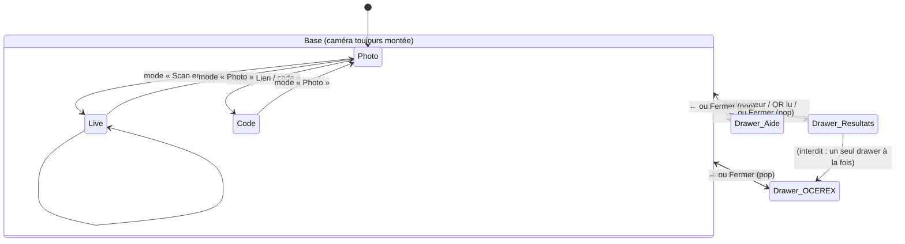
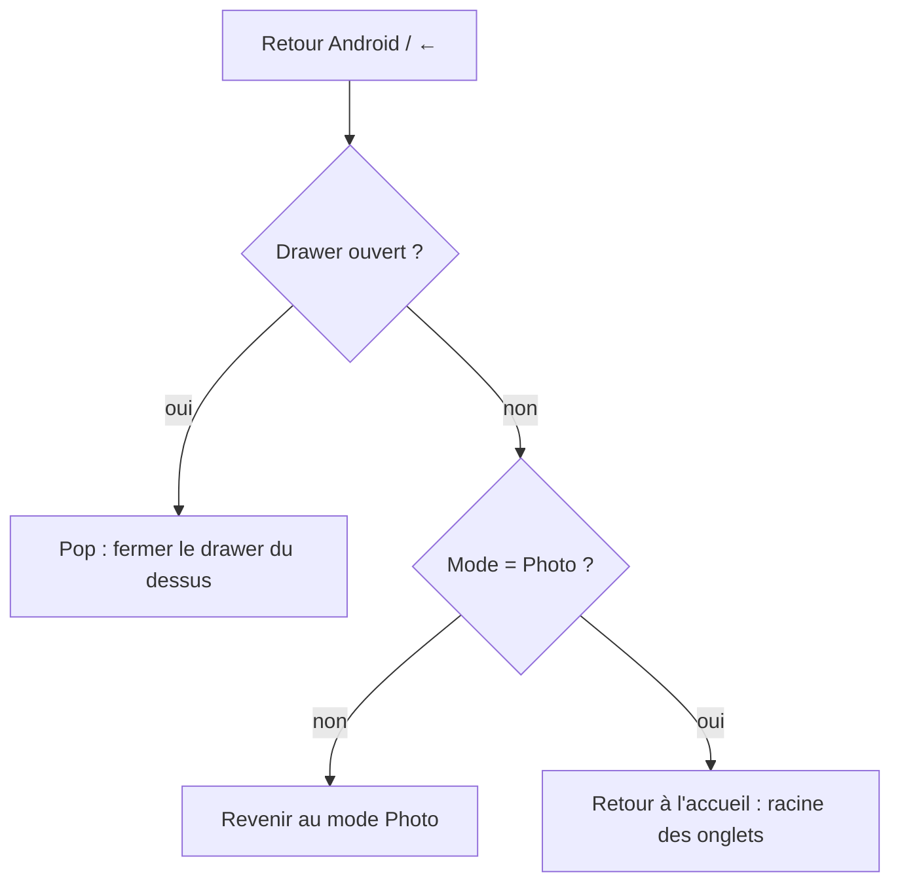

# Lens — خطة التنقل بنظام الطبقات (Drawer)

الحالة: **مقترح، بانتظار الموافقة. لم يُنفَّذ بعد.**
الموكاب التفاعلي: `docs/mockups/lens-mockup.html` (افتحه في المتصفح، زر Android في الأسفل يحاكي زر الرجوع).

## 1. التشخيص: لماذا تتكرر الحلقة الآن؟

| السبب | أين في الكود | الأثر |
|---|---|---|
| الكاميرا نافذة `Modal` مستقلة، وكل لوحة (OCEREX، المساعدة، النتائج) نافذة أخرى فوقها | `LensCamera.tsx` سطر 76، `LensPanel.tsx` سطر 27 | تكديس نوافذ وإغلاقها وإعادة فتحها؛ زر Android يغلق طبقة لا يتوقعها المستعمل |
| إغلاق اللوحة يستدعي `changeMode('photo')` وهذا يعيد الكاميرا | `lens.tsx` `closeOverlay` | الكاميرا تُغلق وتُفتح في كل إغلاق لوحة: الحلقة «خروج ثم دخول» |
| `useFocusEffect` يعيد `cameraOpen = true` عند كل تركيز | `lens.tsx` سطر 175 | أي عودة من مسار آخر تفتح الكاميرا من جديد حتى لو كان المستعمل داخل لوحة |
| `router.push('/cart')` من داخل OCEREX والمكدّس يبقى مفتوحاً | `LensOcerex.tsx` سطر 408 | عند الرجوع تظهر حالة OCEREX القديمة، وهذا ما يسمّيه المستعمل «وجهات قديمة» |
| `onRequestClose` للكاميرا يغلقها بدل أن يعود خطوة | `LensCamera.tsx` سطر 76 | زر Android يخرج من الكاميرا إلى صفحة فارغة |

الخلاصة: الكود يخلط **التنقل بين الشاشات** (expo-router) و**الطبقات المؤقتة** (Modal) و**حالة الكاميرا** في ثلاث آليات مختلفة. لذلك لا يمكن ضمان رجوع صحيح.

## 2. المبدأ الجديد

1. **شاشة Lens واحدة بطبقة قاعدية ثابتة**: الكاميرا (أو وضع الرابط/الرمز) لا تُغلق ولا تُعاد فتحها أبداً أثناء التنقل داخل Lens.
2. **كل ما يعلو الكاميرا درج (Drawer) داخل الشاشة نفسها**، وليس `Modal` ولا مسار route. الدرج يتحرك من الأسفل بانتقال مدروس.
3. **المكدّس يحتوي الدرج فقط**: الأوضاع (صورة / مباشر / رابط-كود) ليست تاريخاً، تبديلها يغلق الأدراج ويضع الوضع الجديد.
4. **زر الرجوع (Android أو السهم) يُغلق الدرج العلوي** ثم يعود إلى الكاميرا. من الكاميرا في وضع الصورة يعود إلى الواجهة الرئيسية (جذر التبويبات، كما هو مطبّق الآن).
5. **قبل أي `router.push` خارج Lens تُغلق كل الأدراج** (مثال: «الذهاب إلى السلة» من OCEREX)، حتى لا تبقى حالة قديمة عند العودة.

## 3. مخطط الحالات (Mermaid)

Règle de la pile :

## 4. Qui affiche quoi

| Couche | Rôle | Composant | Règle de fermeture |
|---|---|---|---|
| Base | Caméra / saisie du code | `LensBase` (vue normale, pas Modal) | jamais fermée par retour |
| Drawer OCEREX | Prix sur capture | `LensDrawer` + contenu OCEREX | ← / Fermer / retour |
| Drawer Aide | Règles | `LensDrawer` + contenu aide | ← / Fermer / retour |
| Drawer Résultats | Fiches (photo, QR, lien, code) | `LensDrawer` + grille | ← / Fermer / retour ; scan remis en marche |
| Watches | Page détail | route `/lens/watches` (garde) | retour de pile normal → Lens |

Le scan en direct reste actif derrière le drawer des résultats mais **ne relit pas** tant qu'un drawer est ouvert (verrou de lecture). À la fermeture, il reprend.

## 5. Ce qui sera supprimé ou remplacé

- `LensPanel.tsx` (Modal) → remplacé par `LensDrawer.tsx` (vue absolue dans Lens).
- `LensHelp.tsx` et `LensOcerex.tsx` : gardent le contenu, changent d'enveloppe.
- `LensResultsSheet.tsx` : devient un drawer (même contenu).
- `overlay`, `cameraOpen`, `useFocusEffect` de `lens.tsx` : supprimés. Remplacés par une seule pile `layers`.
- `LensCamera` : ne gère plus `visible` ni `onRequestClose`; il devient la vue de base.
- Liens profonds `/lens/scan` et `/lens/ocerex` : ouvrent Lens avec un paramètre (`?mode=live` ou `?drawer=ocerex`) au lieu d'une route dédiée.

## 6. Étapes d'exécution (après approbation)

1. Créer `LensDrawer` (animation de translation, fond atténué, ← et ✕) + test de rendu.
2. Remplacer les trois `Modal` par des drawers dans `lens.tsx`; supprimer `overlay`, `cameraOpen`, `useFocusEffect`.
3. Brancher le bouton retour matériel (`BackHandler`, Android) sur `popLayer()` avec la règle de la section 3.
4. Fermer tous les drawers avant `router.push` (OCEREX → panier).
5. Verrou de lecture QR/barcode pendant qu'un drawer est ouvert.
6. Tests : pile (push/pop/mode), règle de retour, aucune réouverture de caméra après fermeture (test unitaire de la pile), `tsc`, `vitest`.
7. APK démo et vérification sur appareil réel, phase par phase.

## 7. Points à confirmer avant exécution

- Un seul drawer à la fois (pas de drawer dans un drawer). Proposé : oui.
- Changer de mode ferme les drawers. Proposé : oui.
- Watches reste une page (route), pas un drawer, car c'est une liste de suivi longue. Proposé : oui.
