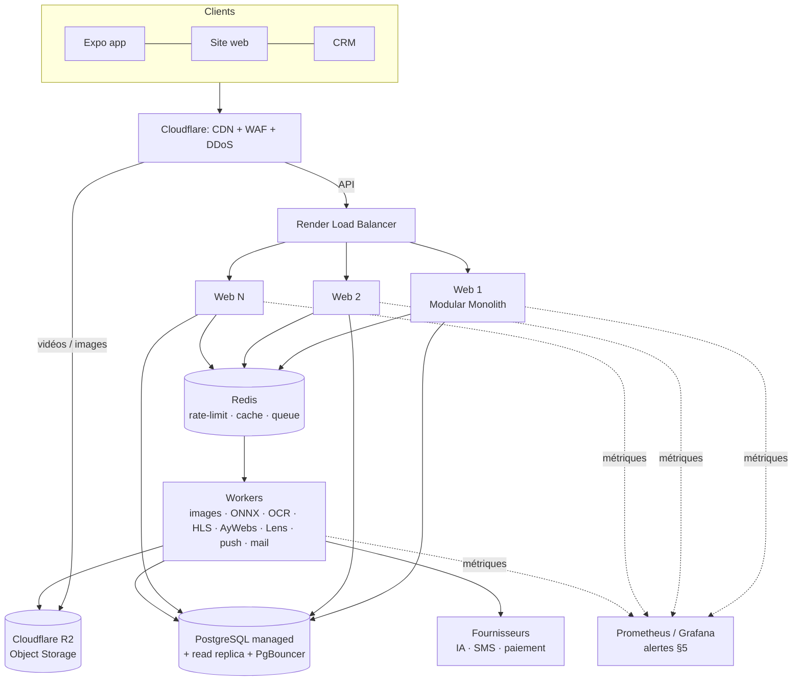

# AYROVI — Scalable Architecture & Infrastructure Audit

**التاريخ:** 12/11/2026 · **النطاق:** Backend + Database + Media + Workers + Monitoring + Load Testing
**المنهجية:** قراءة الكود الكل + قياس حقيقي (load test) على نسخة من الـ server بـ data واقعية (5 000 منتوج، 300 Reel، 300 Publication، **مليون interaction**) — موش تخمين.

---

## 0. الخلاصة في عشرة سطور

1. **تصحيح مهم:** AYROVI موش مبني على NestJS + PostgreSQL + Prisma. الـ stack الحقيقي هو **Express 4 + TypeScript + SQLite (better-sqlite3)**، على **Render Starter** (0,5 vCPU · 512 Mo RAM · disk 1 Go) في Frankfurt. التفاصيل في §1.
2. الكود **أصلاً Modular Monolith** (27 module: `crm`, `erp-core`, `aywebs`, `ayrovix`, `catalogue`…). ما نحتاجوش Microservices، وما نحتاجوش نعاودو نكتبوه بـ NestJS: هذا ما يزيد حتى طلب في الثانية.
3. **القياس:** vCPU واحد يخدم توّا **~1 040 req/s** (كان ~700 قبل التصليحات) على mix القراءات متاع التطبيق، يعني **~6 000 مستخدم نشيط في نفس الوقت** (§3).
4. لقيت **ثلاث نقاط اختناق حقيقية** في الكود وصلّحتهم في هذا الـ audit: compteurs اجتماعية تتعاود تتحسب مع كل طلب (**×18 أسرع**)، listes بلا حدود، و disk يتعبّى بالـ caches (§4).
5. **أكبر خطر توّا موش الـ CPU:** هو **RAM 512 Mo** (175 Mo في الراحة و 286 Mo تحت الضغط، وفوقها OCR، الصور، الـ ONNX)، و**الـ disk 1 Go** اللي فيه الـ base والـ médias والـ backups.
6. **أكبر خطر مع الكبر:** الفيديوات متاع الـ Reels (2–5 Mo للواحد) **يبعثهم الـ process Node بيدّو**. بألف مستخدم يتفرجو يلزم ~1,6 Gbps. لازم **Object Storage + CDN** قبل أي server زايد (§6.3).
7. **وقتاش نزيدو server؟** موش حسب عدد المستخدمين. **الشبكة متاع القرار ولّات code** ومعروضة في الـ CRM: **Modules & environnement → Capacité du serveur** (§5).
8. **PostgreSQL:** ما يلزمش توّا من أجل الـ performance. يلزم وقت نحتاجو **أكثر من instance** (HA و zero-downtime)، أو كي الكتابة (vues) تقرّب من سقف SQLite. التقدير: من مرحلة **1 000–5 000 مستخدم متزامن** (§7).
9. **الخطة:** 4 مراحل (§8)، بعدد السيرفرات والـ CPU والـ RAM والتكلفة التقديرية لكل مرحلة.
10. **قرارات تستنّى صاحب المشروع** (فيها فلوس): نطلعو لـ Render Standard، نكبرو الـ disk لـ 10 Go، و Cloudflare R2 + CDN للميديا (§10).

---

## 1. الحالة الحالية — الـ stack الحقيقي

| العنصر | الحقيقة في الكود | الملاحظة |
|---|---|---|
| Backend | Express 4، bundle بـ esbuild في ملف واحد (`dist/server.js`، ~8 Mo) | `src/server.ts` |
| التنظيم | Modular Monolith: 27 module تحت `src/` | منظم: كل module فيه routes + services + schema |
| Database | **SQLite** (better-sqlite3) بـ WAL، `busy_timeout=5000` | 150 جدول، ~1 560 استدعاء DB في 101 ملف، الكل يتعدّى من `QatafoDatabase` (`get/all/run/transaction`) |
| ORM | **ما فماش** (لا Prisma لا TypeORM): SQL مباشر | ميزة: الـ SQL portable في أغلبو لـ PostgreSQL |
| الاستضافة | Render **Starter**: 0,5 vCPU · 512 Mo · Frankfurt | `render.yaml` |
| Disk | Render disk **1 Go** مركّب على `data/` | فيه الـ base + uploads + backups + (قبل اليوم) الـ caches الكل |
| Médias | `express.static` من `data/uploads` و `assets/media` (فيه فيديوات الـ Reels) | **ما فماش CDN** |
| Cache | Maps في الذاكرة (لكل process) + caches على الـ disk | ما فماش Redis |
| Rate limit | في الذاكرة، داخل الـ process | يخدم مليح مع instance وحدة |
| Background jobs | `setInterval` داخل نفس الـ process: push، mail، backup، FX، price-watch، housekeeping | ما فماش Queue |
| Sessions | في الـ base (`customer_sessions`، `admin_sessions`) | ✅ جاهزة لأكثر من instance |
| خدمة خارجية | Anthropic، SerpAPI، Groq، Gemini، OpenAI، Photoroom، Stripe/Konnect، FX | latency متاعهم I/O، موش CPU |
| Traitement ثقيل داخل الـ process | sharp (صور)، **ONNX u2netp** (détourage محلي)، **tesseract.js** (OCR)، JSDOM (pages المغازات)، pdf | محمي بـ `IMAGE_BUSY`، أما ياكل CPU و RAM متاع الـ web |
| Monitoring | **ما كانش موجود** (غير `/api/health` و `/api/ready`) | ✅ تزاد اليوم (§5) |

### الرسم — البنية الحالية

```
                 ┌──────────── تطبيق Expo / الموقع / الـ CRM ───────────┐
                 └──────────────────────────┬────────────────────────────┘
                                            │ HTTPS (كل شي: API + صور + فيديو)
                          ┌─────────────────▼──────────────────┐
                          │  Render Starter — instance وحدة     │
                          │  0,5 vCPU · 512 Mo RAM              │
                          │ ┌────────────────────────────────┐ │
                          │ │ Node / Express (Modular Monolith)│ │
                          │ │  API · static médias · vidéos    │ │
                          │ │  sharp · ONNX · OCR · JSDOM      │ │
                          │ │  setInterval: push/mail/backup…  │ │
                          │ │  rate-limit + caches en mémoire  │ │
                          │ └───────────────┬────────────────┘ │
                          │        ┌────────▼────────┐          │
                          │        │ Disk 1 Go (data/)│          │
                          │        │ SQLite + uploads │          │
                          │        │ + backups + caches│         │
                          │        └─────────────────┘          │
                          └──────┬─────────────────────┬────────┘
                                 │                     │
                      fournisseurs IA / SMS / paiement   backup S3 (optionnel)
```

**قيد مهم متاع Render:** service عندو disk persistant **ما ينجمش يكبر لأكثر من instance**، و**الـ zero-downtime deploy يتسكّر** (كل deploy فيه انقطاع قصير). يعني مع SQLite على الـ disk، **الكبر الوحيد الممكن هو العمودي** (vertical: machine أكبر). هذا موش عيب توّا، أما هو اللي يحدد وقتاش PostgreSQL يولّي ضروري (§7).

---

## 2. «Modular Monolith + Distributed Infrastructure» — رأيي

الرأي اللي في الطلب **صحيح**، والكود أصلاً ماشي فيه:

- **Modular Monolith:** ✅ موجود. الحاجة الوحيدة الناقصة هي حدود أوضح بين الـ modules في الـ base (كل module يقرأ جداول الآخرين مباشرة). هذا ما يمنعش الكبر.
- **Distributed Infrastructure:** هذا اللي ناقص، ونبنيوه على مراحل:
  1. **الميديا تخرج من الـ process** (Object Storage + CDN). أول حاجة وأرخص حاجة.
  2. **الخدمة الثقيلة تخرج لـ worker** (صور، ONNX، OCR، فيديو، scraping).
  3. **الـ base تولّي مستقلة** (PostgreSQL managed) وقت نحتاجو أكثر من instance.
  4. **Redis** وقتها، للـ rate-limit المشترك والـ cache والـ queue.

**ما ننصحش بـ:** NestJS rewrite، ولا Prisma توّا، ولا Microservices. الثلاثة يكلّفو أسابيع وما يزيدو حتى طلب في الثانية. عنق الزجاجة كان دايماً في الـ SQL، في الميديا، وفي الـ RAM، موش في الـ framework.

---

## 3. القياس — Load Test حقيقي

### الطريقة

- Server مبني (`npm run build:server`) ومربوط على **core واحد** (`taskset -c 0`، يعني **1 vCPU**)، والمولّد متاع الضغط على core آخر باش ما يتزاحموش.
- Data واقعية: 5 011 منتوج، 305 Reel، 313 Publication، **1 038 791 interaction** (vues/likes/partages بتوزيع power law، كيف الواقع: شوية contenus ياخذو أغلب الجمهور).
- **Mix قريب من التطبيق** (`scripts/load-test.mjs`): fil Reels بالصفحات، الكاتالوغ، compteurs، stories، config، fiche produit.
- CPU متاع الـ sandbox: Intel Xeon 2,6 GHz. **Render Starter = 0,5 vCPU، يعني تقريباً نص الأرقام اللي لتحت.**

### النتائج — قبل وبعد التصليحات (1 vCPU)

| Endpoint (وحدو، 50 connexion) | قبل | بعد | السبب |
|---|---:|---:|---|
| `/api/public/social/counts` (12 Reel) | **87 req/s** · p50 575 ms | **1 578 req/s** · p50 27 ms | compteurs matérialisés (×18) |
| `/api/public/social/reels?limit=12` | 542 req/s | **942 req/s** | نفس السبب (vues/likes في الـ feed) |
| `/api/public/social/publications` (بلا pagination) | 135 req/s · 250 Ko | **308 req/s** · 82 Ko (×2,3) | سقف 100 contenu |
| `/api/public/products?limit=24` | 985 req/s | 985 req/s | كان سليم |
| `/api/public/products/:id` | 1 035 req/s | 1 035 req/s | سليم |
| `/api/public/stories` | 1 067 req/s | 1 067 req/s | سليم |
| `/api/ready` | 2 147 req/s | 2 147 req/s | مرجع |

| Mix التطبيق (كل الـ endpoints مخلّطين) | Connexions | req/s | p50 | p99 | أخطاء |
|---|---:|---:|---:|---:|---:|
| **قبل** | 100 | 611 | 158 ms | 354 ms | 0 % |
| **قبل** | 500 | 700 | 723 ms | 1 165 ms | 0 % |
| **قبل** | 1 000 | 661 | — | 1 802 ms | **17 %** |
| **بعد** | 100 | **1 045** | **94 ms** | **196 ms** | 0 % |
| **بعد** | 500 | **1 022** | 532 ms | **697 ms** | 0 % |
| **بعد** | 1 000 | 1 033 | 150 ms | 1 007 ms | 10 % (*) |

**الربح:** **+49 % في الطاقة الاستيعابية** (700 → 1 040 req/s)، والـ p99 تحت 500 connexion **نقص 40 %** (1 165 → 697 ms).

(*) الأخطاء في 1 000 connexion **موش 5xx** (الـ server ما رجّع حتى erreur). هي connexions تستنّى أكثر من 10 ثواني في الـ file TCP متاع core واحد مشبّع. الحد الحقيقي هو **~1 000 req/s لكل vCPU**، و 1 000 connexion مفتوحة مع بعضها أكثر برشا من 1 000 مستخدم حقيقي (مستخدم حقيقي يبعث طلب كل ~6 ثواني، موش connexion مفتوحة ديما).

**الـ métriques الجدد تخدم تحت الضغط:** مباشرة بعد التست، الـ panneau عرض إشارة `EVENT_LOOP_BLOCKED` (p99 = 599 ms > 200 ms)، و جدول «Où part le temps» عرض `/api/public/social` = 43 % من وقت الحساب. يعني الإشارة صحيحة (الـ core كان مشبّع)، والـ route اللي لازم نشوفوها الأولى معروفة.

**Mémoire:** 175 Mo في الراحة، و**286 Mo** تحت 1 000 connexion، من غير OCR ولا ONNX ولا upload. على Starter (512 Mo) **ما يبقاش هامش** وقت يجي pic فيه صور.

**الكتابة (SQLite):** ~13 000 insertion/s للسطر الواحد (WAL). بعد الـ compteurs matérialisés، كل vue = insertion + trigger (O(1))، عوض ما تتعاود تتحسب `COUNT(*)` على مليون سطر.

### من req/s لعدد المستخدمين (قانون Little)

مستخدم نشيط في التطبيق يبعث **~طلب API كل 6 ثواني** (الصور والفيديو يمشيو للـ CDN مهما كان موش للـ API):

> **مستخدمين متزامنين ≈ req/s × 6**

| المستخدمين المتزامنين (المطلوب) | req/s اللازمة | 1 vCPU يكفي؟ |
|---:|---:|---|
| 100 | ~17 | ✅ برشا (1 %) |
| 500 | ~83 | ✅ (~8 %) |
| 1 000 | ~167 | ✅ (~17 %) |
| 5 000 | ~833 | ⚠️ قريب من السقف على القراءات وحدها |
| 10 000 | ~1 667 | ❌ يلزم ~2 vCPU على القراءات وحدها |

⚠️ **معامل أمان ×3:** الـ mix هذا فيه القراءات العامة برك. الترافيك الحقيقي فيه connexion، commandes، كتابة vues، Lens IA، AyWebs (JSDOM)، صور. التقديرات متاع §8 مبنية على **×3** فوق هذي الأرقام.

**ملاحظة على 5 000 و 10 000:** ما نجموش نولّدوهم من machine وحدة بطريقة واقعية. الـ script يدعمهم، أما لازم **أكثر من générateur** على الـ préproduction (§9).

---

## 4. نقاط الاختناق — مرتبة حسب الخطورة

| # | نقطة الاختناق | الأثر | الحالة |
|---|---|---|---|
| B1 | **compteurs اجتماعية** (vues، j'aime، partages…) تتحسب `COUNT(*)` مع كل طلب، **ومع كل vue تتكتب** | 87 req/s، والكتابة تثقل كل ما يكبر الجمهور (SQLite عندو writer واحد) | ✅ **تصلّح**: جدول `social_interaction_totals` بـ triggers SQLite، O(1) |
| B2 | **listes بلا pagination** (`/social/publications`، `/social/reels` بلا `limit`) | 250 Ko للطلب، تكبر مع كل publication | ✅ **تصلّح**: سقف 100 (الـ pagination ما تبدّلتش) |
| B3 | **الـ caches على disk الـ 1 Go** (سقوفها مجموعة > 1 Go) + cache `product-enrichment` **بلا حد** | disk مليان = SQLite ما يكتبش = **السيستام الكل يطيح** | ✅ **تصلّح**: `AYROVI_CACHE_ROOT` (`render.yaml`) + سقف 64 Mo · ⏳ نكبرو الـ disk |
| B4 | **ما فماش monitoring** | ما نعرفوش وقتاش نزيدو server | ✅ **تزاد**: métriques + panneau CRM + Prometheus |
| B5 | **RAM 512 Mo** | 286 Mo تحت الضغط + uploads في الذاكرة (حتى 4×32 Mo) + OCR + ONNX | ⏳ **قرار**: Render Standard (2 Go) |
| B6 | **الفيديوات والصور يبعثهم Node** | bande passante + connexions على 0,5 vCPU | ⏳ **مرحلة 1**: R2 + CDN |
| B7 | **خدمة ثقيلة في الـ process الويب** (sharp، ONNX، OCR، JSDOM، PDF) | تبلوكي الـ event loop على الطلبات الكل | ⏳ **مرحلة 1–2**: worker |
| B8 | **instance وحدة** (SQLite + disk Render) | ما فماش HA، والـ deploy فيه انقطاع | ⏳ **مرحلة 2**: PostgreSQL |
| B9 | **state في الذاكرة** (rate-limit، caches) | يتفرّق كي يولّيو أكثر من instance | ⏳ **مرحلة 2**: Redis |
| B10 | **jobs داخل الـ process** | يتعاودو N مرة مع N instance | ✅ **تحضّر**: `AYROVI_BACKGROUND_JOBS=off` |
| B11 | **Backups** محلية على نفس الـ disk (+ S3 optionnel)، RPO 24 h | نخسرو حتى 24 ساعة كي يصير مشكل | ⏳ نفعّلو S3 + `BACKUP_REQUIRE_EXTERNAL=true`، وننصحو بـ **Litestream** (RPO ثواني) |

---

## 5. وقتاش نزيدو server؟ — الشبكة (ولّات code)

موش حسب عدد المستخدمين. الشبكة مكتوبة في `src/services/opsMetrics.ts` (`OPS_THRESHOLDS`) ومعروضة في الـ CRM. **كل seuil يتحكم عليه على 5 دقايق متتالية** (soutenu)، والتاريخ متاع كل ساعة يتسجّل 90 يوم في `ops_metrics_hourly`.

| الإشارة | الـ seuil | شنوّة نعملو **قبل** ما نشريو |
|---|---|---|
| **CPU** (من الحصة المخصّصة، موش من الـ machine) | ≥ 85 % (critique ≥ 95 %) | نشوفو جدول «Où part le temps de calcul»: الـ route اللي تاكل أكثر وقت **نصلّحوها** (كيف B1). كان سليمة → vertical |
| **RAM** | ≥ 85 % من الـ limite | نلوّجو على fuite ولا pic (uploads، OCR). كان سليمة → palier RAM أكبر |
| **Event loop p99** | > 200 ms | خدمة synchrone (SQL بطيء، صورة، HTML) → index ولا worker |
| **Latency p95** | > 800 ms | **كان الـ event loop مبلوكي:** CPU ولا base على هالـ server. **كان الـ event loop خالي:** نستنّاو fournisseur ولا réseau، و**server زايد ما يبدّل شي** |
| **Erreurs 5xx** | > 1 % | logs بالـ `X-Request-ID` |
| **Disk** | ≥ 80 % (critique ≥ 90 %) | نكبرو الـ disk ولا نخرّجو الميديا |

### شجرة القرار

```
إشارة soutenue (5 min، وتتعاود في التاريخ الساعي)؟
 ├─ لا → ما نشريو شي.
 └─ إيه → «Où part le temps» فيها route وحدة تاكل > 40 % من الوقت؟
       ├─ إيه → نصلّحو الـ route (index، cache، pagination، worker).
       └─ لا → الحمل موزّع وسليم:
             ├─ مازال على SQLite → vertical (Standard → Pro → Pro Plus).
             └─ على PostgreSQL → horizontal (+1 instance web وراء الـ load balancer).
```

### وين نشوفوها

- **CRM:** Modules & environnement → **Capacité du serveur** (يتحدّث كل 30 ثانية).
- **API:** `GET /api/admin/ops/metrics` (صلاحية `settings:read`).
- **Supervision خارجية:** `GET /api/ops/metrics` بصيغة Prometheus (Grafana Cloud، Better Stack…). **مسكّر (404)** حتى نعرّفو `OPS_METRICS_TOKEN` (24 حرف على الأقل) ونبعثوه `Authorization: Bearer …`.
- الـ CPU والـ RAM يتقراو من **الـ quota cgroup** (يعني 0,5 vCPU على Starter، موش عدد الـ cores متاع الـ machine). ينجمو يتفرضو بـ `AYROVI_CPU_LIMIT` و `AYROVI_MEMORY_LIMIT_MB`.

---

## 6. الهندسة المستهدفة — عنصر بعنصر

### 6.1 Backend — server واحد ولا أكثر؟

- **توّا:** instance وحدة تكفي برشا من ناحية الـ CPU (§3). المشكل هو الـ RAM.
- **الكود جاهز لأكثر من instance؟** تقريباً: الـ sessions في الـ base ✅، الـ jobs ينجمو يتسكرو بـ `AYROVI_BACKGROUND_JOBS=off` ✅. الحاجة الوحيدة اللي تمنع هي **SQLite على disk Render** (B8).
- **Node cluster:** ما ننصحوش بيه مع SQLite (process برشا على نفس الملف: الكتابة تتسلسل وتتزاحم). نخلّيو process وحدة للويب، و process ثانية للـ worker وقت يلزم.

### 6.2 Database

- **SQLite توّا:** قراءات سريعة برشا (in-process، بلا réseau). الكتابة سريعة (13k/s خام). مع الـ compteurs matérialisés، **الحد الحقيقي ولّى**:
  1. instance وحدة (لا HA، الـ deploy فيه انقطاع)؛
  2. writer واحد: الـ vues متاع الـ Reels هي أكثر كتابة. تقدير الخطر من **~1 000 vue/s** (يعني ~10 000 مستخدم يتفرجو)؛
  3. الـ backup على نفس الـ disk.
- **PostgreSQL:** §7.
- **الحل المؤقت للـ vues** قبل PostgreSQL: **batching**، نجمعو الـ vues في الذاكرة وندفّقوهم كل 2–5 ثواني في transaction وحدة. يقسم الكتابة على ~100.

### 6.3 Storage — الصور والفيديوات (الأولوية الكبرى)

| توّا | المستهدف |
|---|---|
| `data/uploads` على disk 1 Go، يبعثهم Node | **Cloudflare R2** (S3-compatible، **egress بلاش**) |
| فيديوات Reels في `assets/media` يبعثهم Node | R2 + **CDN Cloudflare** (cache في الـ edge، قريب من تونس) |
| فيديو MP4 كيف ما يتبعث (2–5 Mo) | **Video processing:** transcodage لـ HLS (360p/720p) + poster، بـ worker ffmpeg ولا خدمة (Cloudflare Stream / Mux) |
| صور تتعالج وقت الطلب (`/api/public/media/*`) | تتولّد مرة وحدة (worker) وتتحط في R2، والـ CDN يكاشيها |

**علاش أولوية؟** 1 000 مستخدم كل واحد يتفرج Reel كل 15 ثانية × 3 Mo ≈ **200 Mo/s ≈ 1,6 Gbps**. ما ثماش server Node يحمل هذا. مع CDN، الـ server ما يشوفش حتى octet من الفيديو.

**الخدمة اللي حضّرتها اليوم:** الـ caches اللي تتعاود تتولّد خرجو من الـ disk الـ persistant (`AYROVI_CACHE_ROOT`).

### 6.4 CDN

- **Cloudflare قدّام الدومين:** DDoS، WAF، bots، HTTP/3، cache الميديا.
- **cache الـ API العامة** (كاتالوغ، config، navigation) بـ `s-maxage=30` للطلبات **بلا connexion برك**. توّا الكل `no-store`. هذا يتعمل **مع** إعداد Cloudflare (bypass كي يكون فما cookie/Authorization) باش ما يصيرش تسريب contenu personnalisé. **ما فعّلتوش اليوم بقصد:** ما يتعملش من غير ما يتجرّب الـ CDN.

### 6.5 Cache — Redis؟

- **توّا: لا.** instance وحدة، والـ caches في الذاكرة أسرع من Redis.
- **يولّي لازم مع أول instance ثانية:** rate-limit مشترك (توّا كل instance تحسب وحدها، يعني الحد يتضرب في N)، cache `resolveCache`/`visualSearch`/`search`، و queue (BullMQ). → **Render Key Value** (Redis managed).

### 6.6 Background Workers + Queue

- **توّا:** `setInterval` في الـ process (push 20 s، mail 15 s، backup، FX، price-watch، housekeeping).
- **اليوم:** `AYROVI_BACKGROUND_JOBS=off` يخلّي instance «web برك». القيمة الافتراضية (`on`) ما تبدّل شي.
- **المرحلة 2:** service **worker** مستقل (نفس الكود، `AYROVI_BACKGROUND_JOBS=on`، من غير HTTP عام) + **BullMQ على Redis** للخدمة الثقيلة: صور، ONNX، OCR، transcodage، AyWebs scraping، Lens.

### 6.7 Load Balancer

- **Render يوفّرو وحدو** وقت يكون عندنا أكثر من instance. ما يلزمش نركّبوه.
- **يولّي لازم:** وقت أول instance ثانية، يعني بعد PostgreSQL (§7)، ولا وقت نحبو zero-downtime deploy.

### 6.8 الحماية من الضغط

- ✅ موجود: rate-limits مفصّلة (OTP، checkout، AyWebs، Lens، social، médias…) وحدود على الـ uploads.
- ✅ موجود: `IMAGE_BUSY` (حد للتزامن في معالجة الصور، `Retry-After`).
- ⏳ Cloudflare WAF + rate-limit في الـ edge (قبل ما يوصل الطلب لـ Node).
- ⏳ مع أكثر من instance: rate-limit في Redis.

---

## 7. SQLite → PostgreSQL: وقتاش، وكيفاش؟

### وقتاش (أول شرط يتحقق)

1. نحتاجو **HA / zero-downtime deploy**، يعني instance ثانية؛
2. **CPU soutenu > 70 % على Render Pro (2 vCPU)** بعد ما نصلّحو الـ routes اللي تبان في جدول «Où part le temps»؛
3. **الكتابة:** `SQLITE_BUSY` ولا event loop مبلوكي بالكتابة (الـ vues بعد الـ batching)؛
4. الـ base تفوت **~20–50 Go**.

التقدير: من **1 000–5 000 مستخدم متزامن**.

### كيفاش (من غير Prisma)

- الـ layer متاع الـ base **مركّز** في `QatafoDatabase` (`get/all/run/transaction`). هذي نقطة قوة.
- **الصعوبة الحقيقية:** better-sqlite3 **synchrone** و `pg` **asynchrone**. الـ ~1 560 استدعاء لازمهم يوليو `await`، والـ transactions تتبدّل. هذي أكبر خدمة في المشروع: **~4–6 أسابيع** لمطوّر واحد، مع الـ tests (أكثر من 3 600 test موجودين يحميو المراجعة).
- **التوصية:** `pg` + SQL كيف ما هو (ولا Kysely)، **موش Prisma**: Prisma يفرض إعادة تعريف 150 جدول وإعادة كتابة الـ queries الكل.
- **نحضّرو من توّا:**
  - كل module جديد يكتب الـ DB متاعو من خلال **repository** (interface) باش يتبدّل بسهولة؛
  - ما نزيدوش خصوصيات SQLite (`INSERT OR IGNORE`، `instr`، الـ JSON functions، الـ `PRAGMA`) من غير ما نكتبو مقابلها في PostgreSQL؛
  - الـ triggers متاع الـ compteurs (`src/db/socialTotals.ts`) تتترجم PL/pgSQL كيف ما هي.

---

## 8. الخطة — السيرفرات والـ CPU والـ RAM والتكلفة لكل مرحلة

> **التكلفة تقديرية** (أسعار Render و Cloudflare كيف ما نعرفوها في 11/2026). **لازم تتأكد من صفحة الأسعار قبل أي شراء.** «متزامن» = مستخدم نشيط يبعث طلب كل ~6 ثواني. الـ CPU محسوب بـ **×3 أمان** فوق القياس.

| المرحلة | مستخدمين متزامنين (≈ DAU) | البنية | Web | Database | Redis | Worker | ميديا | تقدير/شهر |
|---|---|---|---|---|---|---|---|---|
| **0 — توّا** | < 100 (< 4k DAU) | instance وحدة | Starter 0,5 vCPU / 512 Mo | SQLite (disk 1 Go) | — | داخل الـ process | Node | ~7–8 $ |
| **0′ — توصية فورية** | 100–500 (4k–20k) | instance وحدة | **Standard 1 vCPU / 2 Go** | SQLite (disk **10 Go**) + backup S3/Litestream | — | داخل الـ process | **R2 + CDN** | ~30–40 $ |
| **1** | 500–1 000 (20k–40k) | vertical | **Pro 2 vCPU / 4 Go** | SQLite (disk 20 Go) + Litestream | — | process ثانية على نفس الـ instance | R2 + CDN + HLS | ~95–120 $ |
| **2** | 1 000–5 000 (40k–200k) | **horizontal** | **2–4 × Pro (2 vCPU / 4 Go)** وراء الـ LB | **PostgreSQL managed 2–4 vCPU / 8 Go** | **1 Go** | **1–2 service** (2 vCPU / 4 Go) | R2 + CDN + HLS | ~450–800 $ |
| **3** | 5 000–10 000+ (200k–400k+) | horizontal + réplicas | **6–8 × Pro** (autoscaling) | **PostgreSQL 8 vCPU / 32 Go + read replica + PgBouncer** | **2–4 Go** | **3–4 service** (autoscaling) | R2 + CDN + Stream/Mux | ~1 500–3 000 $ |

### Vertical ولا horizontal؟

- **Vertical (مرحلة 0′ → 1):** طول ما أحنا على SQLite، هذا الطريق الوحيد، وهو الأرخص والأبسط.
- **Horizontal (مرحلة 2 →):** بعد PostgreSQL + Redis: نزيدو instance web كل ما CPU soutenu > 70 % على الـ instances الكل. الـ workers يكبرو وحدهم حسب طول الـ queue.

### الأرقام متاع الـ disk

1M interaction ≈ 180 Mo في الـ base. مع الصور المحلية والـ backups المحلية (14 يوم)، **1 Go يتعبّى في أشهر**. 10 Go ≈ +2,25 $/شهر.

---

## 9. Load Testing — كيفاش نعاودوه

```bash
# على الـ préproduction (موش الـ production في الـ paliers الكبار)
npm run loadtest -- --url https://staging.example.tn --stages 100,500,1000 --duration 30 --out loadtest.json
```

- **قراءات عامة برك:** ما فماش comptes ولا commandes ولا SMS، يعني ما يوسّخ شي.
- يحبس وحدو كي **p99 > 2 s** ولا **erreurs > 1 %** (`--max-p99`).
- **5 000 / 10 000:** 3–5 générateurs متوازيين (machines مختلفة، لأن الـ rate-limits بالـ IP) ولا k6 Cloud، على الـ préproduction، **ونفس حجم الـ data متاع الـ production**.
- **أثناء التست:** نتبّعو panneau «Capacité du serveur»، يقلّك وين يمشي الوقت ووين الحد.
- **شروط النجاح لكل palier:** p95 < 800 ms، erreurs < 1 %، CPU soutenu < 85 %، RAM < 85 %.

---

## 10. شنوّة تعمل اليوم، وشنوّة يستنّى قرار

### ✅ تعمل اليوم (code، tests، push)

| التصليح | الملفات | الأثر المقاس |
|---|---|---|
| compteurs اجتماعية matérialisés بالـ triggers | `src/db/socialTotals.ts` + 5 قراءات | counts **×18**، fil Reels ×1,7، الكتابة متاع vue O(1) |
| listes بلا pagination: سقف 100 | `src/magazine/publicSocialReads.ts` | payload ثابت مهما كبر المحتوى |
| métriques d'exploitation + signaux + تاريخ ساعي | `src/services/opsMetrics.ts`، `src/server.ts` | الشبكة متاع §5 تخدم |
| panneau CRM «Capacité du serveur» | `client/src/admin/OpsCapacityPanel.tsx` | القرار يتاخذ على الأرقام |
| Prometheus بالـ token | `/api/ops/metrics` | supervision خارجية |
| caches régénérables خارج الـ disk الـ persistant + سقف للـ enrichissement | `src/services/cacheRoot.ts`، `render.yaml` | الـ disk ما يتعبّاش بالـ caches |
| rôle `AYROVI_BACKGROUND_JOBS` | `src/server.ts` | تحضير الـ multi-instance |
| script load test بالـ paliers | `scripts/load-test.mjs`، `npm run loadtest` | يتعاود في أي وقت |

Tests جدد: `tests/social-totals-2026-11-12.test.ts`، `tests/ops-metrics-2026-11-12.test.ts`، `tests/cache-root-2026-11-12.test.ts`.

### ⏳ قرارات صاحب المشروع (فيها فلوس) — بالترتيب

1. **Render Starter → Standard** (1 vCPU / 2 Go): الـ RAM هي أكبر خطر توّا.
2. **Disk 1 Go → 10 Go** (يتكبّر، ما يتصغّرش).
3. **Cloudflare** قدّام الدومين + **R2** للـ uploads وفيديوات الـ Reels.
4. **Backup خارجي:** نعبّيو `BACKUP_S3_*` ونحطو `BACKUP_REQUIRE_EXTERNAL=true` (ولا Litestream).
5. **Supervision:** نعرّفو `OPS_METRICS_TOKEN` ونربطوه بـ Grafana Cloud / Better Stack (alertes بالـ email/SMS على نفس الـ seuils).

### ⏳ الخدمة التقنية الجاية (بعد القرارات)

1. upload الميديا لـ R2 (adapter S3) + migration متاع `data/uploads` و `assets/media/reels-owned`.
2. Batching متاع الـ vues.
3. Worker (process منفصلة) للصور / ONNX / OCR.
4. Transcodage HLS للـ Reels.
5. Cache CDN للـ API العامة (anonyme) مع Cloudflare.
6. تحضير PostgreSQL: repositories للـ modules الجدد، وقائمة الخصوصيات متاع SQLite.

---

## 11. الطلب الأصلي ← وين الجواب

| المطلوب | الجواب |
|---|---|
| 1. Backend: CPU و RAM | §1، §3، §6.1، §8 |
| 2. PostgreSQL / Database مستقلة | §6.2، §7 (التصحيح: توّا SQLite) |
| 3. أكثر من Backend Instance | §1 (قيد Render)، §6.1، §8 مرحلة 2 |
| 4. Load Balancer | §6.7 |
| 5. Cache / Redis | §6.5 |
| 6. Workers و Queue | §6.6 (+ `AYROVI_BACKGROUND_JOBS`) |
| 7. Media: Object Storage، CDN، Video، Image | §6.3، §6.4 |
| 8. الحماية من الضغط | §6.8 |
| 9. Monitoring و Metrics | §5 (code + CRM + Prometheus) |
| 10. Load Testing 100 → 10 000 | §3، §9 (`npm run loadtest`) |
| Architecture Diagram | §1 (توّا)، §12 (المستهدف) |
| عدد السيرفرات و CPU/RAM لكل مرحلة | §8 |
| القدرة الاستيعابية | §3 |
| نقاط الاختناق | §4 |
| توسّع أفقي ورأسي | §8 |
| التكاليف | §8، §10 |

---

## 12. الرسم — البنية المستهدفة (مرحلة 2–3)



```
Clients ─► Cloudflare (CDN + WAF) ─┬─► R2 (vidéos, images)          ◄── Workers (HLS, vignettes)
                                    └─► Load Balancer ─► Web ×N ─┬─► PostgreSQL (+ réplica)
                                                                 └─► Redis ─► Workers ─► fournisseurs
```
