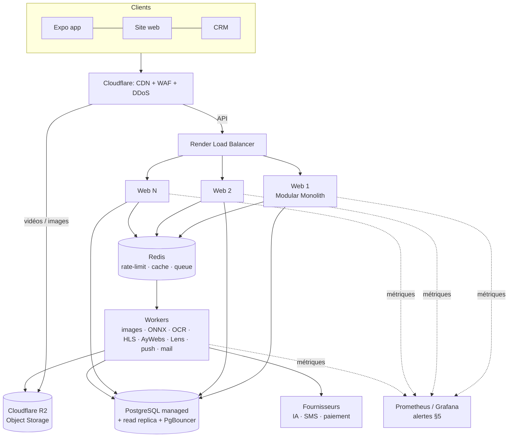

# AYROVI — Scalable Architecture & Infrastructure Audit

**التاريخ:** 12/11/2026 · **النطاق:** Backend + Database + Media + Workers + Monitoring + Load Testing
**المنهجية:** قريت الكود الكل، وكل رقم في التقرير **مقاس**، موش متخمّن:
- **Load test حقيقي** على نسخة من الـ server بـ data واقعية: 5 000 منتوج، 300 Reel، 300 Publication، **مليون interaction**.
- **من 100 لـ 10 000 مستخدم متزامن**: كل مستخدم connexion وحدو ووقت تفكير بين الطلبات.
- **PostgreSQL 18 حقيقي**: نقلنالو الـ schema والـ data الكل، وعاودنا فيه الـ SQL الحقيقي اللي يخدم بيه التطبيق.

الأرقام الخام موجودين في `docs/perf/2026-11-12/`، والسكريبتات تتعاود بكوموند واحدة (§9).

---

## 0. الخلاصة

1. **تصحيح مهم:** AYROVI موش مبني على NestJS + PostgreSQL + Prisma. الـ stack الحقيقي هو **Express 4 + TypeScript + SQLite (better-sqlite3)**، على **Render Starter** (0,5 vCPU · 512 Mo RAM · disk 1 Go). والكود أصلاً **Modular Monolith** (27 module). ما ننصحوش بـ Microservices ولا بإعادة كتابة بـ NestJS.
2. **Load test على المستخدمين المتزامنين (§3):** على **vCPU واحد**:
   - 100 → 4 000 مستخدم متزامن يتعدّاو، و p95 ≤ 47 ms (و 0 erreur بعد تصليح الـ keep-alive).
   - **5 000 هو الحد** (le genou): p95 بين 221 و 1 265 ms حسب الـ run.
   - **10 000 يشبّع** الـ vCPU الواحد.
   - الكبر **خطّي**: ~950–1 000 req/s لكل core.
   - 10 000 مستخدم يلزمهم **~1,75 core مخصّصين للـ server** (2 processus على machine 2–4 vCPU).
3. **PostgreSQL (§7) — قسناه، موش تخمين:**
   - الـ schema يتنقل **100 %**: 161/161 جدول، 236/236 index، 185/185 FK، 191/191 CHECK.
   - الـ data تتنقل **بلا حتى سطر مرفوض**: 1 047 072 سطر.
   - الـ SQL الحقيقي متاع الـ endpoints **30/30 يخدم** (بعد ما صلّحنا الحاجة الوحيدة اللي كانت خاصة بـ SQLite: `rowid`).
   - **أما PostgreSQL أثقل في كل طلب:** ~0,5–1 ms CPU في الـ DB لكل طلب HTTP، مقابل 0,15 ms لـ SQLite داخل الـ process.
4. **هل يلزمنا Database مستقلة؟**
   - **من أجل الـ performance: لا، حتى 10 000 مستخدم متزامن.** الخدمة متاع الـ DB عند 10 000 مستخدم ≈ **0,4 core** على SQLite، والكتابة تخدم بـ **12 %** من طاقتها.
   - **من أجل الاستمرارية: إيه.** الـ DB المستقلة تلزم كي نحتاجو HA (ما يطيحش السيستام كي تطيح machine)، zero-downtime deploy، backup لأي لحظة (PITR)، ولا أكثر من machine للويب.
   - **التوصية:** نبداو الـ migration من ~**2 000–3 000** مستخدم متزامن، وتكون كاملة قبل **~10 000**. تاخذ 4–6 أسابيع (1 651 استدعاء synchrone في 21 module).
5. **صلّحت 6 نقاط اختناق** لقيتهم بالقياس (§4):
   - **déduplication الـ vues:** على Reel مشهور كانت تفلّي **كل** الـ vues متاعو مع كل vue جديدة: **35 ms → 0,02 ms**.
   - **compteurs اجتماعية:** ×18.
   - **listes بلا pagination:** سقف 100 (×2,3).
   - **keep-alive:** كان يسبب 502/ECONNRESET intermittents وراء الـ proxy. توّا **0 erreur**.
   - **disk** يتعبّى بالـ caches.
   - **ما كانش فما monitoring**؛ توّا موجود.
6. **أكبر خطر توّا:** الـ **RAM 512 Mo** (الـ server يوصل ~300 Mo تحت الضغط) والـ **disk 1 Go**.
7. **أكبر خطر مع الكبر:** فيديوات الـ Reels يبعثهم الـ process Node بيدّو. ألف مستخدم يتفرجو ≈ **720 Go في الساعة**. بـ bandwidth Render الزايد (0,15 $/Go) هذا يعمل **~100 $ لكل ساعة pic**. يعني **Object Storage + CDN** قبل أي server زايد (§6.3).
8. **وقتاش نزيدو server؟** الشبكة ولّات code، ومعروضة في الـ CRM: **Modules & environnement → Capacité du serveur** (§5).
9. **الخطة والتكلفة بالأسعار المنشورة متاع Render (§8):**

   | المستخدمين المتزامنين | التكلفة/شهر |
   |---|---|
   | حتى 1 000 | ~30 $ |
   | حتى 4 000 | ~90 $ |
   | حتى 10 000 على machine وحدة | ~180 $ |
   | 10 000+ مع HA | ~700–1 000 $ |

10. **قرارات تستنّى صاحب المشروع** (§10): Render Standard، disk 10 Go، R2 + CDN، backup خارجي.

---

## 1. الحالة الحالية — الـ stack الحقيقي

| العنصر | الحقيقة في الكود | الملاحظة |
|---|---|---|
| Backend | Express 4، bundle بـ esbuild في ملف واحد (`dist/server.js`، ~8 Mo) | `src/server.ts` |
| التنظيم | Modular Monolith: 27 module تحت `src/` | منظم: كل module فيه routes + services + schema |
| Database | **SQLite** (better-sqlite3) بـ WAL، `busy_timeout=5000` | 150 جدول، ~1 560 استدعاء DB في 101 ملف، الكل يتعدّى من `QatafoDatabase` (`get/all/run/transaction`) |
| ORM | **ما فماش** (لا Prisma لا TypeORM): SQL مباشر | ميزة: الـ SQL portable في أغلبو لـ PostgreSQL |
| الاستضافة | Render **Starter**: 0,5 vCPU · 512 Mo · Frankfurt | `render.yaml` |
| Disk | Render disk **1 Go** مركّب على `data/` | فيه الـ base + uploads + backups + (قبل اليوم) الـ caches الكل |
| Médias | `express.static` من `data/uploads` و `assets/media` (فيه فيديوات الـ Reels) | **ما فماش CDN** |
| Cache | Maps في الذاكرة (لكل process) + caches على الـ disk | ما فماش Redis |
| Rate limit | في الذاكرة، داخل الـ process | يخدم مليح مع instance وحدة |
| Background jobs | `setInterval` داخل نفس الـ process: push، mail، backup، FX، price-watch، housekeeping | ما فماش Queue |
| Sessions | في الـ base (`customer_sessions`، `admin_sessions`) | ✅ جاهزة لأكثر من instance |
| خدمة خارجية | Anthropic، SerpAPI، Groq، Gemini، OpenAI، Photoroom، Stripe/Konnect، FX | latency متاعهم I/O، موش CPU |
| Traitement ثقيل داخل الـ process | sharp (صور)، **ONNX u2netp** (détourage محلي)، **tesseract.js** (OCR)، JSDOM (pages المغازات)، pdf | محمي بـ `IMAGE_BUSY`، أما ياكل CPU و RAM متاع الـ web |
| Monitoring | **ما كانش موجود** (غير `/api/health` و `/api/ready`) | ✅ تزاد اليوم (§5) |

### الرسم — البنية الحالية

```
                 ┌──────────── تطبيق Expo / الموقع / الـ CRM ───────────┐
                 └──────────────────────────┬────────────────────────────┘
                                            │ HTTPS (كل شي: API + صور + فيديو)
                          ┌─────────────────▼──────────────────┐
                          │  Render Starter — instance وحدة     │
                          │  0,5 vCPU · 512 Mo RAM              │
                          │ ┌────────────────────────────────┐ │
                          │ │ Node / Express (Modular Monolith)│ │
                          │ │  API · static médias · vidéos    │ │
                          │ │  sharp · ONNX · OCR · JSDOM      │ │
                          │ │  setInterval: push/mail/backup…  │ │
                          │ │  rate-limit + caches en mémoire  │ │
                          │ └───────────────┬────────────────┘ │
                          │        ┌────────▼────────┐          │
                          │        │ Disk 1 Go (data/)│          │
                          │        │ SQLite + uploads │          │
                          │        │ + backups + caches│         │
                          │        └─────────────────┘          │
                          └──────┬─────────────────────┬────────┘
                                 │                     │
                      fournisseurs IA / SMS / paiement   backup S3 (optionnel)
```

**قيد مهم متاع Render:** service عندو disk persistant **ما ينجمش يكبر لأكثر من instance**، و**الـ zero-downtime deploy يتسكّر** (كل deploy فيه انقطاع قصير). يعني مع SQLite على الـ disk، **الكبر الوحيد الممكن هو العمودي** (vertical: machine أكبر). هذا موش عيب توّا، أما هو اللي يحدد وقتاش PostgreSQL يولّي ضروري (§7).

---

## 2. «Modular Monolith + Distributed Infrastructure» — رأيي

الرأي اللي في الطلب **صحيح**، والكود أصلاً ماشي فيه:

- **Modular Monolith:** ✅ موجود. الحاجة الوحيدة الناقصة هي حدود أوضح بين الـ modules في الـ base (كل module يقرأ جداول الآخرين مباشرة). هذا ما يمنعش الكبر.
- **Distributed Infrastructure:** هذا اللي ناقص، ونبنيوه على مراحل:
  1. **الميديا تخرج من الـ process** (Object Storage + CDN). أول حاجة وأرخص حاجة.
  2. **الخدمة الثقيلة تخرج لـ worker** (صور، ONNX، OCR، فيديو، scraping).
  3. **الـ base تولّي مستقلة** (PostgreSQL managed) وقت نحتاجو أكثر من instance.
  4. **Redis** وقتها، للـ rate-limit المشترك والـ cache والـ queue.

**ما ننصحش بـ:** NestJS rewrite، ولا Prisma توّا، ولا Microservices. الثلاثة يكلّفو أسابيع وما يزيدو حتى طلب في الثانية. عنق الزجاجة كان دايماً في الـ SQL، في الميديا، وفي الـ RAM، موش في الـ framework.

---

## 3. Load Testing — 100 / 500 / 1 000 / 5 000 / 10 000 مستخدم متزامن

### 3.1 الطريقة

- **Server مبني** (`npm run build:server`) ومربوط على **core واحد** (`taskset -c 0`، يعني **1 vCPU**، كيف Render Standard). المولّد متاع الضغط على core آخر.
- **Data واقعية:** 5 011 منتوج، 305 Reel، 313 Publication، **1 038 791 interaction** (vues/likes/partages بتوزيع power law: شوية contenus ياخذو أغلب الجمهور، كيف الواقع).
- **مستخدم متزامن = مستخدم حقيقي** (`scripts/load-test.mjs --mode users`):
  - **connexion وحدو** (تليفونو).
  - يبعث طلب من الـ mix متاع التطبيق: fil Reels، كاتالوغ، compteurs، stories، config، fiche produit.
  - **يفكّر ~6 ثواني** (عشوائي بين 3 و 9) ومن بعد يعاود.
  - الـ départs موزّعين على 15 ثانية، ومن بعدها **60 ثانية قياس**.
- **الحكم متاع كل palier هو نفس الشبكة متاع الـ monitoring (§5):** **p95 ≤ 800 ms** و **erreurs ≤ 1 %**.
- **المولّد يراقب روحو:** كان الـ event loop متاعو يتأخر أكثر من 100 ms، الـ palier يتسمّى «générateur saturé» وما نعتمدوش عليه. ما صارتش.
- **حالة الـ server** (CPU، RAM، event loop) تتقرا من `/api/ops/metrics` **أثناء** الضغط.
- CPU الـ sandbox: Intel Xeon 2,6 GHz.

### 3.2 النتائج — server واحد (1 vCPU)

| مستخدمين متزامنين | req/s مطلوبة | req/s محققة | p50 | p95 | p99 | erreurs | CPU server | RAM (RSS) | الحكم |
|---:|---:|---:|---:|---:|---:|---:|---:|---:|:--:|
| **100** | 17 | 17 | 3 ms | 7 ms | 12 ms | 0 % | 6 % | 203 Mo | ✅ |
| **500** | 83 | 84 | 2 ms | 8 ms | 37 ms | 0,06 % (*) | 16 % | 202 Mo | ✅ |
| **1 000** | 167 | 166 | 2 ms | 8 ms | 36 ms | 0 % | 30 % | 227 Mo | ✅ |
| 3 000 | 500 | 498 | 3 ms | 27 ms | 90 ms | 0 % | 62 % | 277 Mo | ✅ |
| 4 000 | 667 | 664 | 5 ms | 47 ms | 106 ms | 0 % | 66 % | 293 Mo | ✅ |
| **5 000** | 833 | 789–825 | 11–39 ms | **221–1 265 ms** | 314–1 916 ms | 0–0,16 % | 74–90 % | 297–303 Mo | ⚠️ le genou |
| **10 000** | 1 667 | **997** | 895 ms | 5 353 ms | 9 359 ms | **22,5 %** (timeouts) | ~100 % | 297 Mo | ❌ saturé |

(*) هذي الـ erreurs «réseau» (ECONNRESET) سببها الـ keep-alive متاع Node، اللي كان 5 ثواني. تصلّح (§4، B13)، ومن بعد التصليح كل الـ paliers من 1 000 لـ 5 000 طلعو **0 erreur**.

**5 000 عاودناه 3 مرات:** p95 = 221، 1 265 و 264 ms. هذا هو بالضبط اللي تقولو نظرية الطوابير: الـ CPU بين 80 و 90 %، والـ latency تتقلّب. **الطاقة المريحة متاع vCPU واحد ≈ 4 000 مستخدم متزامن**، و 5 000 هو الحد.

### 3.3 النتائج — 2 processus على نفس الـ machine (`scripts/web-cluster.cjs`)

| مستخدمين متزامنين | req/s محققة | p50 | p95 | p99 | erreurs | الحكم |
|---:|---:|---:|---:|---:|---:|:--:|
| **5 000** | 830 | 3 ms | **86 ms** | 138 ms | 0 % | ✅ (مقابل 221–1 265 ms على processus واحد) |
| **10 000** | 1 025–1 210 | 338–1 124 ms | 1 258–2 673 ms | — | 8–13 % | ❌ (شوف لتحت) |

**علاش 10 000 ما تعدّاش، وشنوّة نستنتجو؟** الـ sandbox فيه **2 cores برك**، والمولّد يخدم على نفس الـ machine. قسنا الـ CPU لكل process أثناء الـ palier:
- الـ machine كانت **200 % (الزوز cores مشبّعين، 0 % idle)**؛
- الـ processus الأولاني: 0,60 core، والثاني: 0,67 core؛
- المولّد: 0,33 core؛
- الباقي للـ kernel (الـ TCP متاع 10 000 connexion من الجهتين).

يعني الـ server خذا **1,27 core** وعطى **1 210 req/s**، أي **~950 req/s لكل core**: **الكبر خطّي**. باش نخدمو 10 000 مستخدم (1 667 req/s) يلزم **~1,75 core مخصّصين للـ server وحدو**:
- **Render Pro (2 vCPU) + 2 processus:** على الحد؛
- **Render Pro Plus (4 vCPU) + 3–4 processus:** مريح.

باش نثبتو 10 000 بالقياس المباشر، يلزم مولّد على machine أخرى (§9).

### 3.4 قبل وبعد التصليحات — test الـ saturation (1 vCPU، بلا وقت تفكير)

| Endpoint (وحدو، 50 connexion) | قبل | بعد | السبب |
|---|---:|---:|---|
| `/api/public/social/counts` (12 Reel) | **87 req/s** · p50 575 ms | **1 578 req/s** · p50 27 ms | compteurs matérialisés (×18) |
| `/api/public/social/reels?limit=12` | 542 req/s | **942 req/s** | نفس السبب |
| `/api/public/social/publications` (بلا pagination) | 135 req/s · 250 Ko | **308 req/s** · 82 Ko | سقف 100 contenu (×2,3) |
| `/api/public/products?limit=24` | 985 req/s | 985 req/s | كان سليم |

| Mix التطبيق | 100 connexion | 500 connexion |
|---|---|---|
| **قبل** | 611 req/s · p99 354 ms | 700 req/s · p99 1 165 ms |
| **بعد** | **1 045 req/s** · p99 196 ms | **1 022 req/s** · p99 697 ms |

**الربح:** **+49 % في الطاقة** (700 → 1 040 req/s لكل vCPU) و **−40 % في الـ p99**.

### 3.5 القدرة الاستيعابية — الخلاصة

| الـ machine | processus | مريح (CPU ≤ 70 %) | الحد | ملاحظة |
|---|---:|---:|---:|---|
| Render Starter (0,5 vCPU / 512 Mo) | 1 | ~1 500 | ~2 500 | **الـ RAM هي اللي تحكم:** ~300 Mo تحت الضغط، والـ OCR والصور ما يلقاوش بلاصة |
| Render Standard (1 vCPU / 2 Go) | 1 | **~4 000** | ~5 000 | **مقاس** |
| Render Pro (2 vCPU / 4 Go) | 2 | ~7 000 | ~10 000 | خطّي، مقاس بـ 1,27 core |
| Render Pro Plus (4 vCPU / 8 Go) | 3–4 | ~14 000 | ~20 000 | تقدير خطّي |

⚠️ **معامل أمان:** الـ mix هذا فيه القراءات العامة برك. الترافيك الحقيقي فيه زادة connexion، commandes، vues، Lens IA، AyWebs (JSDOM) وصور. الخطة متاع §8 تقسم هذي الأرقام على **~2**.

**بالـ DAU (تقريب):** كان الجلسة الواحدة ~10 دقايق والـ pic ~4 % من الـ DAU، يعني 1 000 متزامن ≈ 25 000 DAU. هذا فرض لازم يتعاير على أرقام الـ production.

---

## 4. نقاط الاختناق — مرتبة حسب الخطورة

| # | نقطة الاختناق | الأثر المقاس | الحالة |
|---|---|---|---|
| B1 | **compteurs اجتماعية** (vues، j'aime، partages…) تتحسب بـ `COUNT(*)` مع كل طلب ومع كل vue | 87 req/s، والكلفة تكبر مع الجمهور | ✅ **تصلّح:** جدول `social_interaction_totals` بـ triggers، O(1)، ×18 |
| B2 | **listes بلا pagination** (`/social/publications`، `/social/reels` بلا `limit`) | 250 Ko للطلب، وتكبر مع كل publication | ✅ **تصلّح:** سقف 100 (×2,3) |
| B3 | **الـ caches على disk الـ 1 Go:** سقوفها مجموعة تفوت 1 Go، وواحد فيهم بلا حد | disk مليان = SQLite ما يكتبش = **السيستام الكل يطيح** | ✅ **تصلّح:** `AYROVI_CACHE_ROOT` + سقف 64 Mo · ⏳ نكبرو الـ disk |
| B4 | **ما كانش فما monitoring** | ما نعرفوش وقتاش نزيدو server | ✅ **تزاد:** métriques + panneau CRM + Prometheus |
| B12 | **déduplication الـ vue تفلّي كل الـ vues متاع الـ contenu.** الـ index الـ unique partiel موجود، أما الـ requête ما تكتبش الـ prédicat متاعو (`type IN ('view','share')`)، فالـ planner ما ينجمش يستعملو | **35 ms لكل vue** على Reel فيه 37 000 vue، **داخل transaction الكتابة**. Reel viral كان يتسقّف في **~28 vue/s**، والكلفة تكبر مع الشهرة. PostgreSQL عندو نفس القاعدة | ✅ **تصلّح:** **0,02 ms** (×1 500)، و test يثبّت الـ plan متاع التنفيذ |
| B13 | **keep-alive متاع Node = 5 s** وهو أقصر من الـ proxy متاع Render | **ECONNRESET intermittents** في الـ load test (1 → 74 erreur حسب الـ palier)، وفي الـ production يوليو **502 intermittents** | ✅ **تصلّح:** `keepAliveTimeout` 120 s و `headersTimeout` 125 s (`HTTP_KEEP_ALIVE_TIMEOUT_MS`). **0 erreur** بعد التصليح |
| B14 | **fenêtre « 1 min » متاع الـ monitoring** كانت الدقيقة الحالية برك، ومقسومة على 60 s | الأرقام ترجع لـ ~0 بعد كل `hh:mm:00` (dents de scie في Prometheus) | ✅ **تصلّح:** fenêtre glissante حقيقية (هذا غلط في الكود متاعي، لقيتو أثناء الـ load test) |
| B5 | **RAM 512 Mo** | ~300 Mo تحت الضغط، وفوقها uploads في الذاكرة (حتى 4×32 Mo)، OCR و ONNX | ⏳ **قرار:** Render Standard (2 Go) |
| B6 | **الفيديوات والصور يبعثهم Node** | bande passante (~720 Go/ساعة لكل 1 000 مستخدم يتفرجو) + connexions | ⏳ **مرحلة 1:** R2 + CDN |
| B15 | **processus Node واحد = core واحد** | machine 2 أو 4 vCPU ما تزيد شي من غير أكثر من processus | ✅ **تحضّر:** `scripts/web-cluster.cjs` (مقاس: الكبر خطّي) |
| B7 | **خدمة ثقيلة في الـ process الويب** (sharp، ONNX، OCR، JSDOM، PDF) | تبلوكي الـ event loop على الطلبات الكل | ⏳ **مرحلة 1–2:** worker |
| B8 | **instance وحدة** (SQLite + disk Render) | ما فماش HA، والـ deploy فيه انقطاع | ⏳ **مرحلة 3:** PostgreSQL (§7) |
| B9 | **state في الذاكرة** (rate-limit، caches) | يتفرّق مع أكثر من instance | ⏳ مع PostgreSQL: Redis |
| B10 | **jobs داخل الـ process** | يتعاودو N مرة مع N instance | ✅ **تحضّر:** `AYROVI_BACKGROUND_JOBS=off` |
| B11 | **Backups** محلية على نفس الـ disk (+ S3 optionnel)، RPO 24 h | نخسرو حتى 24 ساعة كي يصير مشكل | ⏳ S3 + `BACKUP_REQUIRE_EXTERNAL=true`، وننصحو بـ **Litestream** (RPO ثواني) |

---

## 5. وقتاش نزيدو server؟ — الشبكة (ولّات code)

موش حسب عدد المستخدمين. الشبكة مكتوبة في `src/services/opsMetrics.ts` (`OPS_THRESHOLDS`) ومعروضة في الـ CRM. **كل seuil يتحكم عليه على 5 دقايق متتالية** (soutenu)، والتاريخ متاع كل ساعة يتسجّل 90 يوم في `ops_metrics_hourly`.

| الإشارة | الـ seuil | شنوّة نعملو **قبل** ما نشريو |
|---|---|---|
| **CPU** (من الحصة المخصّصة، موش من الـ machine) | ≥ 85 % (critique ≥ 95 %) | نشوفو جدول «Où part le temps de calcul»: الـ route اللي تاكل أكثر وقت **نصلّحوها** (كيف B1). كان سليمة → vertical |
| **RAM** | ≥ 85 % من الـ limite | نلوّجو على fuite ولا pic (uploads، OCR). كان سليمة → palier RAM أكبر |
| **Event loop p99** | > 200 ms | خدمة synchrone (SQL بطيء، صورة، HTML) → index ولا worker |
| **Latency p95** | > 800 ms | **كان الـ event loop مبلوكي:** CPU ولا base على هالـ server. **كان الـ event loop خالي:** نستنّاو fournisseur ولا réseau، و**server زايد ما يبدّل شي** |
| **Erreurs 5xx** | > 1 % | logs بالـ `X-Request-ID` |
| **Disk** | ≥ 80 % (critique ≥ 90 %) | نكبرو الـ disk ولا نخرّجو الميديا |

### شجرة القرار

```
إشارة soutenue (5 min، وتتعاود في التاريخ الساعي)؟
 ├─ لا → ما نشريو شي.
 └─ إيه → «Où part le temps» فيها route وحدة تاكل > 40 % من الوقت؟
       ├─ إيه → نصلّحو الـ route (index، cache، pagination، worker).
       └─ لا → الحمل موزّع وسليم:
             ├─ مازال على SQLite → vertical (Standard → Pro → Pro Plus).
             └─ على PostgreSQL → horizontal (+1 instance web وراء الـ load balancer).
```

### وين نشوفوها

- **CRM:** Modules & environnement → **Capacité du serveur** (يتحدّث كل 30 ثانية).
- **API:** `GET /api/admin/ops/metrics` (صلاحية `settings:read`).
- **Supervision خارجية:** `GET /api/ops/metrics` بصيغة Prometheus (Grafana Cloud، Better Stack…). **مسكّر (404)** حتى نعرّفو `OPS_METRICS_TOKEN` (24 حرف على الأقل) ونبعثوه `Authorization: Bearer …`.
- الـ CPU والـ RAM يتقراو من **الـ quota cgroup** (يعني 0,5 vCPU على Starter، موش عدد الـ cores متاع الـ machine). ينجمو يتفرضو بـ `AYROVI_CPU_LIMIT` و `AYROVI_MEMORY_LIMIT_MB`.

---

## 6. الهندسة المستهدفة — عنصر بعنصر

### 6.1 Backend — server واحد ولا أكثر؟

- **توّا:** server واحد بـ 1 vCPU يكفي حتى **~4 000 مستخدم متزامن** (مقاس، §3). **المشكل الحالي هو الـ RAM** (Starter = 512 Mo).
- **Node يستعمل core واحد للـ JavaScript.** كي نكبرو الـ machine لـ 2 ولا 4 vCPU، لازم نشغّلو **أكثر من processus**. `scripts/web-cluster.cjs` يعمل هذا بالضبط، بالقواعد هاذي:
  - processus n°1 يطلع وحدو (migrations)، ويخلّي الـ jobs المجدولة عندو؛
  - الباقين يطلعو بعدو بـ `AYROVI_BACKGROUND_JOBS=off`؛
  - كل processus ياخذ حصّتو من الـ CPU والـ RAM (باش الإشارات متاع §5 تبقى صحيحة)؛
  - processus يطيح يتعاود يطلع، و SIGTERM يتعدّى لكل processus باش يسكّر بنظافة.
- **مقاس:**
  - 2 processus على نفس ملف SQLite (WAL) يخدمو مع بعضهم **بلا حتى erreur**؛
  - الطاقة **خطّية** (~950 req/s لكل core)؛
  - p95 متاع 5 000 مستخدم هبط من 221–1 265 ms لـ **86 ms**.
- **حدود لازم تتعرف** (هذا علاش ما بدّلتش الـ `startCommand` في `render.yaml`؛ القرار لصاحب المشروع):
  - الـ rate-limits في الذاكرة لكل processus، يعني الحد الفعلي ×N؛
  - محاولات الـ connexion والـ caches تتفرّقو بين الـ processus؛
  - الـ panneau متاع الـ CRM يعرض الـ processus اللي جاوب الطلب.
- **أكثر من machine:** يستحق PostgreSQL (§7)، خاطر Render ما يكبّرش service عندو disk لأكثر من instance.

### 6.2 Database

التحليل الكامل متاع PostgreSQL، والقرار متاع الـ «Database مستقلة»، في **§7**. الخلاصة:
- SQLite يحمل الخدمة متاع الـ DB لـ 10 000 مستخدم متزامن بـ ~0,4 core؛
- PostgreSQL يلزم من أجل الـ HA وأكثر من machine، موش من أجل السرعة.

### 6.3 Storage — الصور والفيديوات (الأولوية الكبرى)

| توّا | المستهدف |
|---|---|
| `data/uploads` على disk 1 Go، يبعثهم Node | **Cloudflare R2** (S3-compatible، **egress بلاش**) |
| فيديوات Reels في `assets/media` يبعثهم Node | R2 + **CDN Cloudflare** (cache في الـ edge، قريب من تونس) |
| MP4 يتبعث كيف ما هو (2–5 Mo) | **Video processing:** transcodage لـ HLS (360p/720p) + poster، بـ worker ffmpeg ولا خدمة (Cloudflare Stream / Mux) |
| صور تتعالج وقت الطلب (`/api/public/media/*`) | تتولّد مرة وحدة (worker) وتتحط في R2، والـ CDN يكاشيها |

**علاش أولوية؟** 1 000 مستخدم، كل واحد يتفرج Reel كل 15 ثانية، × 3 Mo = **200 Mo/s ≈ 1,6 Gbps ≈ 720 Go في الساعة**. Render يحسب الـ bandwidth الزايد بـ **0,15 $/Go** (فوق الـ 25 Go المضمّنين في الـ workspace Pro). يعني **~108 $ لكل ساعة pic**، وما فماش server Node يحمل هذا الـ débit. مع R2 + CDN، الـ server ما يشوف حتى octet من الفيديو. أسعار R2 لازم تتأكد قبل التعاقد.

**الخدمة اللي تعملت:** الـ caches اللي تتعاود تتولّد خرجو من الـ disk الـ persistant (`AYROVI_CACHE_ROOT`).
### 6.4 CDN

- **Cloudflare قدّام الدومين:** DDoS، WAF، bots، HTTP/3، cache الميديا.
- **cache الـ API العامة** (كاتالوغ، config، navigation) بـ `s-maxage=30` للطلبات **بلا connexion برك**. توّا الكل `no-store`. هذا يتعمل **مع** إعداد Cloudflare (bypass كي يكون فما cookie/Authorization) باش ما يصيرش تسريب contenu personnalisé. **ما فعّلتوش اليوم بقصد:** ما يتعملش من غير ما يتجرّب الـ CDN.

### 6.5 Cache — Redis؟

- **توّا: لا.** instance وحدة، والـ caches في الذاكرة أسرع من Redis.
- **يولّي لازم مع أول instance ثانية:** rate-limit مشترك (توّا كل instance تحسب وحدها، يعني الحد يتضرب في N)، cache `resolveCache`/`visualSearch`/`search`، و queue (BullMQ). → **Render Key Value** (Redis managed).

### 6.6 Background Workers + Queue

- **توّا:** `setInterval` في الـ process (push 20 s، mail 15 s، backup، FX، price-watch، housekeeping).
- **اليوم:** `AYROVI_BACKGROUND_JOBS=off` يخلّي instance «web برك». القيمة الافتراضية (`on`) ما تبدّل شي.
- **المرحلة 2:** service **worker** مستقل (نفس الكود، `AYROVI_BACKGROUND_JOBS=on`، من غير HTTP عام) + **BullMQ على Redis** للخدمة الثقيلة: صور، ONNX، OCR، transcodage، AyWebs scraping، Lens.

### 6.7 Load Balancer

- **Render يوفّرو وحدو** وقت يكون عندنا أكثر من instance. ما يلزمش نركّبوه.
- **يولّي لازم:** وقت أول instance ثانية، يعني بعد PostgreSQL (§7)، ولا وقت نحبو zero-downtime deploy.

### 6.8 الحماية من الضغط

- ✅ موجود: rate-limits مفصّلة (OTP، checkout، AyWebs، Lens، social، médias…) وحدود على الـ uploads.
- ✅ موجود: `IMAGE_BUSY` (حد للتزامن في معالجة الصور، `Retry-After`).
- ⏳ Cloudflare WAF + rate-limit في الـ edge (قبل ما يوصل الطلب لـ Node).
- ⏳ مع أكثر من instance: rate-limit في Redis.

---

## 7. PostgreSQL — التحليل المقاس، والحاجة لـ Database مستقلة

### 7.1 كيفاش قسنا (موش تخمين)

1. **`scripts/sql-capture.cjs`:** يشغّل الـ server الحقيقي ويسجّل **كل requête SQL** يعملها كل endpoint من الـ mix، ومعاها transaction متاع vue Reel.
   - النتيجة: **2,9 requête SQL لكل طلب HTTP** في المعدّل.
   - وقت الـ DB لكل طلب: ~0,03–0,65 ms.
2. **`scripts/pg-capacity-bench.mjs`** على **PostgreSQL 18.6 حقيقي** (`shared_buffers` 256 Mo، `synchronous_commit=on`)، مربوط على **1 vCPU** كيف SQLite باش المقارنة تكون عادلة. يعمل:
   - **audit للكود:** يحسب الاستدعاءات synchrone والحاجات الخاصة بـ SQLite، module بـ module؛
   - **ترجمة آلية للـ schema:** كل جدول، contrainte، FK، index؛
   - **نقل الـ data الكل**، والسطور المرفوضة تتحسب، ما تتخبّاش؛
   - **يعاود الـ SQL الحقيقي كيف ما هو.** الترجمة الوحيدة: `?`→`$n` و `GROUP_CONCAT`→`string_agg`؛
   - **يقيس القراءة والكتابة** بـ 1 لـ 64 connexion، ومعاها الـ CPU لكل طلب في PostgreSQL وفي الـ driver.

### 7.2 التوافق (compatibility)

| العنصر | النتيجة |
|---|---|
| الجداول | **161/161** ✅ |
| UNIQUE / index | **55/55** · **236/236** ✅ (9 `COLLATE NOCASE` تنحّاو، شوف لتحت) |
| CHECK / Foreign keys | **191/191** · **185/185** ✅ |
| Triggers | 7 (compteurs) → **تكتبو بالـ PL/pgSQL** وخدمو |
| Data | **1 047 072 سطر في 16 s، 0 مرفوض** |
| SQL الحقيقي متاع الـ endpoints | **30/30** ✅. قبل التصليح 28/30: `ORDER BY cp.rowid` (`rowid` ما يوجدش في PostgreSQL) تبدّل بـ `cp.product_id`، ونفس الترتيب بالضبط |

**الخدمة الحقيقية متاع الـ migration موش في الـ schema، هي في الكود:**

| الحاجة في `src/` (297 ملف) | العدد | التحويل |
|---|---:|---|
| **استدعاءات DB synchrone** (`db.get/all/run`) | **1 651** | لازم يوليو `await` (better-sqlite3 synchrone و `pg` asynchrone). **هذي أكبر خدمة** |
| transactions | 119 | `BEGIN/COMMIT` على client من الـ pool |
| `LIKE` | 85 | في SQLite ما يفرّقش بين الحروف الكبار والصغار، وفي PostgreSQL يفرّق → `ILIKE` وين يلزم |
| `COLLATE NOCASE` | 43 (+9 index) | `lower()` + index على `lower(col)`، ولا `citext` |
| `INSERT OR IGNORE` / `OR REPLACE` | 40 / 3 | `ON CONFLICT DO NOTHING` / `DO UPDATE` |
| `PRAGMA` / `sqlite_master` | 41 / 27 | migrations و introspection → `information_schema` |
| `rowid` | 11 (خارج الـ hot path: purchasing، fees AyWebs، migrations) | عمود صريح |
| `IFNULL` / `GROUP_CONCAT` / `instr` / dates / `IS NOT` | 11 / 4 / 2 / 4 / 2 | `COALESCE` / `string_agg` / `strpos` / `to_char` / `IS DISTINCT FROM` |

**الـ modules اللي فيهم أكثر استدعاءات:** customer 245، admin 229، db 188، aywebs 177، arrival-ingestion 166، crm 109، catalogue 105.

⚠️ **الـ collation:** SQLite يرتّب الـ TEXT بالـ octets. لازم نصنعو قاعدة PostgreSQL بـ **`LC_COLLATE 'C'`** (كيف ما عملنا في الـ bench)، وإلا الترتيب يتبدّل (حروف كبار وصغار، accents)، وحتى الـ dates المخزّنة TEXT ISO ما تبقاش تتقارن كيف ما يلزم.

### 7.3 القدرة المقاسة — vCPU واحد للقاعدة

**القراءة:** نفس الـ mix متاع الـ load test (20 طلب HTTP، 2,9 requête لكل طلب)

| | connexions | طلب HTTP/s | p50 | p99 | CPU PostgreSQL / طلب | CPU driver `pg` / طلب (يتزاد على الـ server الويب) |
|---|---:|---:|---:|---:|---:|---:|
| **SQLite** (داخل الـ process) | — | **6 465** | 0,16 ms | 0,46 ms | **0,155 ms** (الكل) | — |
| PostgreSQL، requêtes عادية | 1 | 685 | 1,4 ms | 5,3 ms | 0,93 ms | 0,52 ms |
| | 4 | 1 109 | 2,9 ms | 11 ms | 0,86 ms | 0,35 ms |
| | 16 | 955 | 15 ms | 45 ms | 1,01 ms | 0,39 ms |
| | 64 | 966 | 64 ms | **190 ms** | 0,99 ms | 0,35 ms |
| **PostgreSQL، requêtes préparées** | 1 | 1 023 | 1,0 ms | 2,7 ms | 0,56 ms | 0,42 ms |
| | **4** | **1 849** | 1,8 ms | 8,9 ms | **0,49 ms** | 0,30 ms |
| | 16 | 1 802 | 7,9 ms | 28 ms | 0,53 ms | 0,31 ms |
| | 64 | 1 535 | 37 ms | **152 ms** | 0,62 ms | 0,34 ms |

**الكتابة:** transaction حقيقية متاع vue Reel (10 requêtes + trigger compteur)

| | connexions | vues/s (contenus متفرّقين) | vues/s («Reel viral»: الـ vues الكل على نفس الـ compteur) | p99 |
|---|---:|---:|---:|---:|
| **SQLite** | 1 writer | **5 561** | **6 347** | 0,8 ms |
| PostgreSQL | 1 | 484 | 493 | 3–4 ms |
| | 4 | **911** | **833** | 8–11 ms |
| | 16 | 789 | 674 | 30–39 ms |

**قراءة الأرقام:**
- **في نفس الـ CPU، SQLite أسرع بـ 3,5 لـ 7 مرات.** خاطر يخدم داخل الـ process: ما فماش réseau ولا protocole ولا ré-analyse. PostgreSQL ما يزيدش السرعة لـ server واحد.
- **الـ requêtes préparées ×1,8.** هذا أرخص تحسين متاع الـ migration، ولازم يكون من الأول.
- **الـ connexions:** أحسن نتيجة بين **4 و 16 connexion لكل vCPU**. مع 64، الـ p99 يتضرب ×5–6. يعني pool صغير (5–10 لكل processus)، و **PgBouncer** كي تكثر الـ instances.
- **«Reel viral»** (الكل يكتبو على نفس السطر) **ما طيّحش PostgreSQL** (833 vue/s). الـ verrou متاع السطر يتسلسل أما يبقى معقول.
- **فخ لقيناه أثناء القياس:** `pool.query()` في `pg-pool` **يكسّر الـ connexion مع كل erreur**، والـ connexion الجديدة = fork. قبل ما نصلّحو الـ requête متاع `rowid`، الـ bench طاح من ~1 000 لـ **129 طلب/s**. يعني: ما نستعملوش الـ erreurs SQL باش نسيّرو الـ logique (مثلاً catch على UNIQUE)، نستعملو `ON CONFLICT`.
- **الـ latency:** 2,9 requête تتبعث وحدة بعد وحدة، كل وحدة × RTT (0,3–1 ms في نفس الـ région) = **+1–3 ms لكل طلب**. ما تأثّرش، **بشرط** القاعدة تكون في **Frankfurt** كيف الـ server.
- **الكلفة على الـ server الويب:** الـ driver يزيد 0,3–0,5 ms CPU لكل طلب، و SQLite (0,155 ms) يخرج من الـ process. يعني **~20–25 % أقل req/s لكل vCPU ويب** بعد الـ migration.

### 7.4 الضغط المتوقع لكل palier

**الفرضيات:** كل مستخدم متزامن يبعث 1 طلب كل 6 ثواني، و 1 vue كل 15 ثانية.

| مستخدمين متزامنين | طلبات/s | vues/s | CPU الـ DB مع **SQLite** | CPU الـ DB مع **PostgreSQL مُحضّر** | PostgreSQL عادي | PostgreSQL المقترح (×2 أمان، ≤ 60 %) |
|---:|---:|---:|---:|---:|---:|---|
| 100 | 17 | 7 | 0,004 core | 0,02 core | 0,02 core | Basic-1gb (0,5 CPU) |
| 500 | 83 | 33 | 0,02 core | 0,08 core | 0,12 core | Basic-1gb |
| 1 000 | 167 | 67 | 0,04 core | 0,16 core | 0,24 core | Pro-4gb (1 vCPU) |
| 5 000 | 833 | 333 | 0,19 core | 0,82 core | 1,2 core | **2–4 vCPU** |
| 10 000 | 1 667 | 667 | **0,38 core** | **1,6 core** | 2,4 core | **4–8 vCPU** + replica |

**الكتابة:** عند 10 000 مستخدم يلزم 667 vue/s. هذا **12 %** من طاقة SQLite، أما **75–85 % من vCPU PostgreSQL للـ vues وحدهم**.

### 7.5 الحكم — هل يلزمنا Database مستقلة؟

**من أجل الـ performance: لا، حتى 10 000 مستخدم متزامن.**
- الخدمة متاع الـ DB تبقى تحت **0,4 core**، والكتابة تخدم بـ 12 % من طاقتها (بعد تصليح B12).
- الحد الحقيقي هو الـ CPU متاع الويب (Express/JSON). هذا يتحل بأكثر من processus على machine وحدة (§6.1)، وتنجم توصل لـ 8 vCPU على Render (Pro Ultra).

**من أجل الاستمرارية والكبر: إيه، و PostgreSQL managed هو الحل**، وقت يتحقق أول شرط من هاذم:
1. **الـ HA ولّى ضروري تجارياً:** machine وحدة + disk = كي تطيح، الكل يطيح، وكل deploy فيه انقطاع؛
2. **الويب يحتاج أكثر من machine:** Render ما يكبّرش service عندو disk لأكثر من instance؛
3. **backup لأي لحظة (PITR)، read replicas، تحاليل** ما تثقّلش على الـ production؛
4. الـ base تفوت **~20–50 Go**.

**التوصية الزمنية:**
- **نبداو** الـ migration من ~**2 000–3 000 مستخدم متزامن** (ولا قبل، كان الانقطاع ولّى غير مقبول)؛
- تكون **كاملة قبل ~10 000**، وقتها machine وحدة توصل لحدها المريح؛
- **المدة: 4–6 أسابيع** لمطوّر واحد. الـ 3 700+ test يحميو الخدمة.

### 7.6 كيفاش نعملو الـ migration (من غير Prisma)

0. **من توّا:**
   - كل module جديد يمر بـ repository؛
   - ما نزيدوش حاجات خاصة بـ SQLite من غير ما نكتبو مقابلها؛
   - نعاودو `npm run pg:bench` على كل release كبير.
1. **نعاودو `sql-capture` و `pg-capacity-bench` على نسخة من قاعدة الـ production:** نتأكدو إنو ما فماش حتى سطر مرفوض بالـ data الحقيقية.
2. **interface `DbClient` asynchrone** (`get/all/run/transaction` يرجّعو promises): أول implémentation بـ better-sqlite3 (بلا حتى تبديل في السلوك)، ومن بعد نحوّلو الـ modules واحد بواحد لـ `async/await`، بداية بالـ hot path (magazine، catalogue، public).
3. **implémentation `pg`:**
   - **requêtes préparées**؛
   - pool من 5–10 لكل processus؛
   - `statement_timeout`؛
   - قاعدة بـ `LC_COLLATE 'C'`؛
   - `ON CONFLICT` عوض الـ catch على الـ erreurs.
4. **Staging:** الـ schema والـ data بنفس المنطق متاع الـ bench (مليون سطر = 16 s)، و load test بـ `--mode users`.
5. **الـ bascule:** fenêtre قصيرة، ونخلّيو نسخة SQLite للـ rollback.
6. **من بعد:** PgBouncer، read replica، وأكثر من instance ويب وراء الـ load balancer.

---

## 8. الخطة — السيرفرات والـ CPU والـ RAM والتكلفة لكل مرحلة

**الطاقة** مأخوذة من القياس (§3.5، §7.4) ومقسومة على ~2 أمان.
**الأسعار** هي الأسعار المنشورة متاع Render في 2026: web Standard 25 $ (1 vCPU/2 Go)، Pro 85 $ (2/4)، Pro Plus 175 $ (4/8)، Pro Ultra 450 $ (8/32)؛ Postgres Basic-1gb 19 $، Pro-4gb 55 $، Pro-8gb 100 $ (الـ HA يضرب سعر القاعدة في 2)؛ Key Value (Redis) Standard 32 $؛ bandwidth زايد 0,15 $/Go. المصادر: [render.com/pricing](https://render-web.onrender.com/pricing)، [tutorsbot](https://tutorsbot.com/blog/render-pricing-2026-plans-cost)، [hostwares](https://hostwares.com/tools/render-cost-calculator).
**لازم تتأكد من صفحة Render قبل أي شراء.** الـ workspace (Hobby/Pro)، الـ disk (~0,25 $/Go) و R2 يتحسبو وحدهم.

| المرحلة | مستخدمين متزامنين | البنية | Web | Database | Redis | Worker | ميديا | تقدير/شهر |
|---|---|---|---|---|---|---|---|---|
| **0 — توّا** | < 300 | instance وحدة | Starter 0,5 vCPU / **512 Mo** | SQLite (disk 1 Go) | — | داخل الـ process | Node | ~7 $ |
| **A — فوراً** | حتى ~1 000–2 000 | instance وحدة | **Standard 1 vCPU / 2 Go** | SQLite (disk **10 Go**) + backup S3/Litestream | — | داخل الـ process | **R2 + CDN** | **~30 $** |
| **B** | 2 000–4 000 | vertical | **Pro 2 vCPU / 4 Go** + `web-cluster` (2 processus) | SQLite (disk 20 Go) + Litestream | — | processus على نفس الـ machine | R2 + CDN + HLS | **~90–100 $** |
| **C** | 4 000–10 000 | vertical، **نبداو الـ migration لـ PostgreSQL** | **Pro Plus 4 vCPU / 8 Go** + `web-cluster` (3–4 processus) | SQLite (disk 20–50 Go) + Litestream | — | processus مخصّص (صور/OCR) | R2 + CDN + HLS | **~180–200 $** |
| **D** | 10 000–30 000، **مع HA** | **horizontal** | **3–4 × Pro (2 vCPU / 4 Go)** وراء الـ load balancer (autoscaling) | **PostgreSQL Pro-8gb (2 vCPU)** + standby HA، و 4 vCPU كي يفوت الـ CPU 60 % | **Standard 1 Go** | **1 × Pro** (BullMQ) | R2 + CDN + Stream | **~700–1 000 $** |
| **E** | 30 000+ | horizontal + réplicas | 6–10 × Pro (autoscaling) | PostgreSQL 8+ vCPU + read replica + PgBouncer | Pro 5 Go | 2–4 workers (autoscaling) | R2 + CDN + Stream/Mux | **~2 000–3 500 $** |

### Vertical ولا horizontal؟

- **Vertical (من 0 لـ C):** طول ما أحنا على SQLite، هذا هو الطريق، وهو الأرخص والأبسط.
  - **مهم:** فوق 1 vCPU، الـ machine الأكبر ما تزيد شي من غير `web-cluster`.
  - الكبر مقاس وخطّي: ~950–1 000 req/s لكل core.
- **Horizontal (من D):** بعد PostgreSQL + Redis، نزيدو instance ويب كل ما الـ CPU يقعد فوق 70 % على الـ instances الكل. الـ workers يكبرو حسب طول الـ queue.

### الـ disk

مليون interaction ≈ 180 Mo في الـ base. مع الصور المحلية والـ backups المحلية (14 يوم)، **1 Go يتعبّى في أشهر**.

---

## 9. Load Testing — كيفاش نعاودوه

```bash
# 1) مستخدمين متزامنين (الجواب على 100 / 500 / 1 000 / 5 000 / 10 000)
ulimit -n 65535   # من الجهتين
npm run loadtest -- --mode users --url https://staging.example.tn \
  --stages 100,500,1000,5000,10000 --think 6 --ramp 15 --duration 60 \
  --ops-token "$OPS_METRICS_TOKEN" --out users.json

# 2) Saturation (أقصى req/s، بلا وقت تفكير)
npm run loadtest -- --url https://staging.example.tn --stages 100,500,1000 --duration 30

# 3) PostgreSQL: الـ SQL الحقيقي + قياس الطاقة (قاعدة JETABLE: الـ bench يفرّغها)
npm run sql:capture -- --db /tmp/copie.sqlite --out sql-capture.json
npm run pg:bench -- --sqlite /tmp/copie.sqlite --pg-url postgres://…/bench \
  --capture sql-capture.json --out pg-bench.json

# 4) Server بأكثر من processus (على machine فيها أكثر من vCPU)
AYROVI_WEB_CONCURRENCY=2 node scripts/web-cluster.cjs
```

- **قراءات عامة برك:** ما فماش comptes ولا commandes ولا SMS، يعني ما يوسّخ شي. `sql:capture` يكتب vue وحدة، فيلزم **نسخة** من الـ base.
- **5 000 / 10 000:** المولّد لازم يكون على **machine أخرى** غير الـ server (في الـ sandbox، المولّد والـ kernel كلاو 0,7 core من 2، §3.3). ويلزم **أكثر من générateur** كان الـ rate-limits بالـ IP، ونفس حجم الـ data متاع الـ production.
- **شروط النجاح لكل palier** (نفس الشبكة متاع §5):
  - p95 ≤ 800 ms؛
  - erreurs ≤ 1 %؛
  - CPU < 85 %؛
  - RAM < 85 %؛
  - الـ event loop متاع المولّد < 100 ms.

---

## 10. شنوّة تعمل، وشنوّة يستنّى قرار

### ✅ تعمل (code، tests، push)

| التصليح / الإضافة | الملفات | الأثر المقاس |
|---|---|---|
| compteurs اجتماعية matérialisés بالـ triggers | `src/db/socialTotals.ts` | counts **×18**، fil Reels ×1,7 |
| **déduplication الـ vue تستعمل الـ index unique partiel** | `src/magazine/socialInteractions.ts` | **35 ms → 0,02 ms** لكل vue على Reel مشهور |
| listes بلا pagination: سقف 100 | `src/magazine/publicSocialReads.ts` | ×2,3، payload ثابت |
| **keep-alive 120 s** (> proxy) | `src/services/httpTimeouts.ts` | ECONNRESET/502 intermittents → **0** |
| métriques + signaux + تاريخ ساعي + **fenêtre glissante صحيحة** | `src/services/opsMetrics.ts` | الشبكة متاع §5 تخدم، وأرقامها مستقرة |
| panneau CRM «Capacité du serveur» | `client/src/admin/OpsCapacityPanel.tsx` | القرار يتاخذ على الأرقام |
| caches خارج الـ disk الـ persistant + سقف | `src/services/cacheRoot.ts`، `render.yaml` | الـ disk ما يتعبّاش |
| **أكثر من processus على machine وحدة** | `scripts/web-cluster.cjs` | الكبر خطّي، 5 000 مستخدم: p95 86 ms |
| **load test بالمستخدمين المتزامنين** | `scripts/load-test.mjs --mode users` | 100 → 10 000 |
| **capture SQL + bench PostgreSQL** | `scripts/sql-capture.cjs`، `scripts/pg-capacity-bench.mjs` | §7 كامل |
| ترتيب portable للمنتوجات المرتبطة | `src/services/contentProducts.ts` | `rowid` → `product_id` (30/30 على PostgreSQL) |

**Tests جدد:** `tests/social-totals-2026-11-12.test.ts` (فيه test الـ plan متاع الـ index)، `tests/ops-metrics-2026-11-12.test.ts` (فيه الـ fenêtre)، `tests/cache-root-2026-11-12.test.ts`، `tests/http-timeouts-2026-11-12.test.ts`.
**الأرقام الخام:** `docs/perf/2026-11-12/`.

### ⏳ قرارات صاحب المشروع (فيها فلوس) — بالترتيب

1. **Render Starter → Standard** (1 vCPU / 2 Go، 25 $): الـ RAM هي أكبر خطر توّا.
2. **Disk 1 Go → 10 Go:** يتكبّر وما يتصغّرش.
3. **Cloudflare** قدّام الدومين + **R2** للـ uploads وفيديوات الـ Reels: الـ bandwidth متاع الفيديو هو أكبر تكلفة مخبّية.
4. **Backup خارجي:** نعبّيو `BACKUP_S3_*` ونحطو `BACKUP_REQUIRE_EXTERNAL=true` (ولا Litestream).
5. **Supervision:** نعرّفو `OPS_METRICS_TOKEN` ونربطوه بـ Grafana Cloud / Better Stack (alertes على نفس الـ seuils).
6. **وقت نوصلو للمرحلة B:** نبدّلو الـ `startCommand` لـ `node scripts/web-cluster.cjs` بعد ما نقراو الحدود متاع §6.1.
7. **وقت نوصلو لـ ~2 000–3 000 مستخدم متزامن:** نبداو الـ migration لـ PostgreSQL (§7.6).

### ⏳ الخدمة التقنية الجاية

1. upload الميديا لـ R2 (adapter S3) + migration متاع `data/uploads` و `assets/media/reels-owned`.
2. Batching متاع الـ vues (اختياري بعد B12).
3. Worker (processus منفصل) للصور / ONNX / OCR.
4. Transcodage HLS للـ Reels.
5. Cache CDN للـ API العامة (anonyme) مع Cloudflare.
6. PostgreSQL: interface `DbClient` asynchrone ومن بعد تحويل الـ modules (§7.6).

---

## 11. الطلب الأصلي ← وين الجواب

| المطلوب | الجواب |
|---|---|
| 1. Backend: CPU و RAM | §3.2، §3.5، §6.1، §8 |
| 2. **PostgreSQL، قدرتو على الضغط المتوقع، والحاجة لـ Database مستقلة** | **§7** (مقاس على PostgreSQL 18 حقيقي: التوافق §7.2، الطاقة §7.3، الضغط المتوقع لكل palier §7.4، الحكم §7.5، الطريقة §7.6) |
| 3. أكثر من Backend Instance | §6.1 (`web-cluster`)، §8 مرحلة D |
| 4. Load Balancer | §6.7 |
| 5. Cache / Redis | §6.5 |
| 6. Workers و Queue | §6.6 (+ `AYROVI_BACKGROUND_JOBS`) |
| 7. Media: Object Storage، CDN، Video، Image | §6.3، §6.4 |
| 8. الحماية من الضغط | §6.8، §4 (B13) |
| 9. Monitoring و Metrics | §5 (code + CRM + Prometheus) |
| 10. **Load Testing 100 / 500 / 1 000 / 5 000 / 10 000** | **§3** (مستخدمين متزامنين حقيقيين، 1 و 2 processus)، §9 |
| Architecture Diagram | §1 (توّا)، §12 (المستهدف) |
| عدد السيرفرات و CPU/RAM لكل مرحلة | §8 |
| القدرة الاستيعابية | §3.5، §7.4 |
| نقاط الاختناق | §4 |
| توسّع أفقي ورأسي | §8 |
| التكاليف | §8، §6.3 (الـ bandwidth)، §10 |

---

## 12. الرسم — البنية المستهدفة (المراحل D–E)



```
Clients ─► Cloudflare (CDN + WAF) ─┬─► R2 (vidéos, images)          ◄── Workers (HLS, vignettes)
                                    └─► Load Balancer ─► Web ×N ─┬─► PostgreSQL (+ réplica)
                                                                 └─► Redis ─► Workers ─► fournisseurs
```
